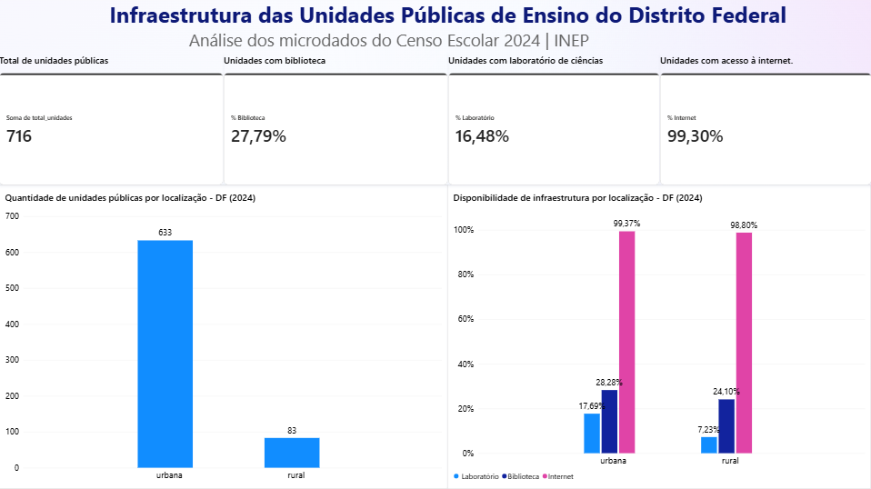

# infraestrutura das escolas públicas do distrito federal

este projeto analisa a infraestrutura das unidades públicas de ensino do Distrito Federal, utilizando os microdados do **Censo Escolar 2024**, disponibilizados pelo INEP.

o objetivo é investigar a disponibilidade de bibliotecas, laboratórios de ciências e acesso à internet, buscando identificar diferenças entre unidades urbanas e rurais e entre as dependências administrativas.

a análise foi desenvolvida com **Python, SQL e Power BI**, desde a exploração e o tratamento dos dados até a construção do dashboard.

## dashboard — Power BI



o dashboard apresenta os principais indicadores de infraestrutura das 716 unidades analisadas, além de uma comparação entre áreas urbanas e rurais.

**[acessar o arquivo do Power BI (.pbix)](dashboard/infraestrutura_escolas_df_2024.pbix)**

## principais resultados

foram analisadas **716 unidades públicas em atividade** no Distrito Federal, sendo 633 urbanas e 83 rurais.

### disponibilidade dos recursos

| indicador | unidades | percentual |
|---|---:|---:|
| biblioteca | 199 | 27,79% |
| laboratório de ciências | 118 | 16,48% |
| acesso à internet | 711 | 99,30% |

o acesso à internet está presente em praticamente todas as unidades analisadas. já bibliotecas e laboratórios de ciências apresentam uma disponibilidade bem menor.

### comparação entre áreas urbanas e rurais

| indicador | urbanas | rurais |
|---|---:|---:|
| biblioteca | 28,28% | 24,10% |
| laboratório de ciências | 17,69% | 7,23% |
| acesso à internet | 99,37% | 98,80% |

a maior diferença aparece nos laboratórios de ciências, presentes em 17,69% das unidades urbanas e em apenas 7,23% das rurais.

a disponibilidade de bibliotecas também é menor nas unidades rurais, enquanto o acesso à internet apresenta percentuais semelhantes nos dois grupos.

### presença simultânea dos recursos

ao analisar a combinação dos três indicadores, dois resultados chamam a atenção:

- **451 unidades (62,99%)** possuem somente acesso à internet entre os recursos analisados.
- **54 unidades (7,54%)** possuem biblioteca, laboratório de ciências e internet simultaneamente.

isso mostra que a ampla presença de internet não significa que os demais recursos de infraestrutura estejam igualmente disponíveis.

### biblioteca e sala de leitura

durante a análise, também foi identificada uma diferença importante entre os indicadores de biblioteca e de biblioteca e/ou sala de leitura.

- **27,79%** das unidades possuem biblioteca.
- **88,27%** possuem biblioteca e/ou sala de leitura.

essas informações são representadas por variáveis diferentes nos microdados do INEP e, por isso, foram analisadas separadamente.

## ferramentas utilizadas

- **Python:** leitura, filtragem, tratamento e análise exploratória dos microdados.
- **SQL (SQLite):** armazenamento, consultas e validação dos indicadores.
- **Power BI:** construção do dashboard e criação das medidas DAX.
- **Git e GitHub:** versionamento e documentação do projeto.

## dados e metodologia

os dados foram obtidos no [portal de microdados do Censo Escolar — INEP](https://www.gov.br/inep/pt-br/acesso-a-informacao/dados-abertos/microdados/censo-escolar).

o recorte considera unidades públicas do Distrito Federal em atividade, pertencentes às dependências administrativas federal e distrital.

das 716 unidades analisadas, **11 são federais e 705 distritais**.

alguns pontos são importantes para a interpretação dos resultados:

- o conjunto analisado inclui unidades com funções educacionais específicas, não apenas escolas de ensino regular;
- os percentuais foram calculados considerando o total de unidades de cada grupo;
- a comparação entre as dependências federal e estadual deve considerar a diferença no tamanho dos grupos;
- a presença de internet não indica necessariamente a qualidade da conexão;
- os resultados representam o recorte analisado e não devem ser generalizados para todas as escolas brasileiras.

os microdados originais e o banco de dados SQLite são mantidos localmente e não são enviados ao GitHub.

## estrutura do projeto

```text
infraestrutura-escolas-publicas/
│
├── data/                         # dados locais não versionados
│   └── .gitignore
│
├── sql/                          # scripts e consultas sql
│
├── dashboard/
│   ├── dashboard_df_2024.png
│   └── infraestrutura_escolas_df_2024.pbix
│
├── analise_infraestrutura.py     # análise exploratória em python
│
└── README.md                     # documentação do projeto
```

para reproduzir a análise, é necessário obter os microdados do Censo Escolar 2024 no portal oficial do INEP.

---

**fonte:** INEP — Microdados do Censo Escolar 2024.
